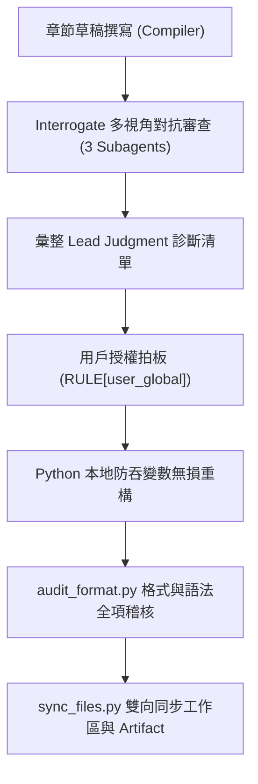

# 《中學微積分先修專著》AI 工具鏈與編輯原則規範手冊

> **本手冊定位**：本手冊是《中學微積分先修專著》全套書系（正文、解答手冊、黑板道場）的最高編輯型別合約與 AI 輔助創作工程化作業指引。後續所有章節之撰寫、重構、審查與交付，均須 100% 嚴格依循本規範執行。

---

## 第一部分：出版級教材編輯原則（Editorial Principles）

### 一、讀者定位與對話語態規範
1. **讀者畫像**：
   - 14 歲中學資優自學者（國二升國三、國三升高一）。
   - 先備知識：代數一元一次/二元一次方程式、因式分解、二次函數配方法、平面直角坐標系幾何。
   - 認知特徵：邏輯敏銳、反感空洞說教與口號、遇到沒交代動機的公式會本能抗拒、重視每一步推演的合法性依據。
2. **語調語態（去說教感規程）**：
   - **嚴禁自居居高臨下的說教者**。
   - **全書嚴禁出現「讀者」二字**（例如「讀者在國中學過...」、「請讀者牢牢記住...」等典型 AI 廢話一律抹殺）。
   - 統一使用平視、自然的對話語態：「我們在國中都學過...」、「請在腦海中記下...」、「若嘗試使用中學方法...」或直接以短句客觀陳述。

---

### 二、四拍首尾閉環寫作架構（The 4-Beat Closed Loop）
全書每一個核心小節與概念，均須具備獨立、自洽的四拍結構，嚴禁出現孤島知識點或突降公式：

```text
【第一拍：承前 (Anchor)】 
  --> 從國中已知的直觀幾何或物理經驗出發（如等速運動、割線斜率、一次直線、好算的開平方）。
【第二拍：起意 (Motivation)】 
  --> 揭示傳統工具的崩潰點或痛點（如變速運動時零除以零、手繪切線直尺顫抖、非線性曲線難以手算）。
【第三拍：推演 (Deduction)】 
  --> 引入微積分代數或幾何算子，嚴格以兩階段模型（代數約分解除未定式 -> 極限趨勢鎖定值）推導。
【第四拍：結實 (Fulfillment)】 
  --> 落地為實用工具或解題 SOP，並以數值殘差、幾何證明或工程量測實例驗證，首尾閉環。
```

---

### 三、概念動機與「以直代曲」落地規範
針對任何涉及「逼近」、「近似」或「微小量」的概念，必須遵守以下動機鋪陳鏈，嚴禁未講先用：
1. **先痛點後工具**：先舉出計算困境（例如已知 $\sqrt{100} = 10$，手邊沒有計算機如何心算估計 $\sqrt{101}$），讓學生深刻體會到為什麼需要簡化工具。
2. **定義什麼是逼近**：明確界定「逼近（Approximation）」即是用簡單好算的一次直線，去替代複雜難算的非線性曲線，並證明誤差極小。
3. **幾何平坦化直覺**：藉由局部放大圖（圖 1-3），展現平滑曲線在切點附近與切線高度重合的幾何本質（以直代曲）。
4. **代數公式嚴密拆解**：
   $$f(x_0 + \Delta x) \approx f(x_0) + f'(x_0)\Delta x$$
   嚴格形式補齊高階極小誤差項 $o(\Delta x)$：
   $$f(x_0 + \Delta x) = f(x_0) + f'(x_0)\Delta x + o(\Delta x)$$
   分別清楚標示：基準點高度 $f(x_0)$、切線爬升修正量 $f'(x_0)\Delta x$、高階殘差 $o(\Delta x)$。
5. **物理例題的工程落地**：
   在物理運動學例題中，若涉及極小時間段的平均速度，**嚴禁得出「平均速度逼近瞬間速度」這種倒退結論**。必須明確闡述工程量測背景：現實測速雷達與感測器在硬體上無法取 $\Delta t = 0$，微積分瞬時速度理論反過來為儀器採樣的極限誤差（誤差率 $< 0.03\%$）提供了精度與執法合法性背書。

---

### 四、作業難度嚴格對齊律（Difficulty Parity Rule）
1. **作業難度絕不比例題難**：
   - 例題教什麼，習題就練什麼。例題只有單項式與二次多項式，習題絕不搞三次多項式、高階乘法展開或奇異分式。
   - 所有習題必須有前面的例題作為直接鏡像對稱支撐。
2. **階梯難度分層**：
   - 基礎演練：直接套用例題的標準 SOP（如一次、二次切線）。
   - 物理應用：更換物理情境（如自由落體、高鐵加速、鉛直上拋、水槽注水），考察量綱審查。
   - 估算實戰：鏡像對稱的數值近似（如手算平方數、手算根號估算）。
   - 觀念通透：兩階段代數規則辨析與概念本質問答。

---

### 五、微積分求切線標準五步法（SOP 執行卡）
全書例題與解答手冊統一遵循「標準五步法」，步驟名稱與編號全域嚴格一致：

| 步驟編號 | 標準步驟名稱 | 具體動作與合約 |
| :--- | :--- | :--- |
| **第一步** | 【確認目標與切點】 | 標明已知函數 $f(x)$ 與切點坐標 $(x_0, y_0)$。 |
| **第二步** | 【列出導函數定義】 | 完整寫出極限定義式 $f'(x) = \lim_{\Delta x \to 0} \frac{f(x+\Delta x)-f(x)}{\Delta x}$。 |
| **第三步** | 【代入展開求導函數】 | 代入函數，分子展開因式分解，在 $\Delta x \neq 0$ 前提下約去分母，取極限求出 $f'(x)$。 |
| **第四步** | 【代入切點求切線斜率】| 將橫坐標 $x_0$ 代入導函數求出斜率數值 $m = f'(x_0)$。 |
| **第五步** | 【點斜立式與切線檢驗】| 用點斜式寫出 $y - y_0 = m(x - x_0)$ 化為截距式，並進行代數配方全域證明或幾何檢驗。 |

---

### 六、禁令辭典與符號規範（Negative Constraint Dictionary）
在任何章節輸出與修改中，以下項目嚴格觸發紅線，計數必須維持為 0：

1. **禁令稱呼**：`讀者`（全數刪除，改用客觀直述或自然平視對話）。
2. **禁令浮誇標籤**：`第一性原理`、`登場`、`出鞘`、`利刃`、`秒殺`、`神器`。
3. **禁令口語/非在地化詞彙**：
   - 嚴禁`隔壁點` $\implies$ 統一使用數學標準詞「**鄰近點**」。
   - 嚴禁`匀速` $\implies$ 統一使用繁體正規詞「**等速直線運動**」。
   - 嚴禁`塑膠尺` $\implies$ 統一使用「**直尺**」。
4. **禁令錯別字**：
   - 嚴禁「帶入」 $\implies$ 一律使用「**代入**」。
   - 嚴禁「做標 / 座標準」 $\implies$ 一律使用「**平面直角坐標系**」。
5. **禁令標點符號**：
   - **嚴禁任何長破折號**（`——`、`—`），改用逗號、冒號或拆成獨立短句。
   - 嚴禁中途冒號（一句話中間突然冒出冒號），冒號僅用於標題或引導完整公式區塊。

---

## 第二部分：AI 工具鏈與自動化流水線（AI Toolchain）

為保證長篇專著在多人/多次對話推進中不發生幻覺、退化或格式崩潰，建立以下四重 AI 自動化流水線：



---

### 一、Interrogate 多視角對抗審查子代理人隊列
每次完成新章節或大型修訂後，必須平行啟動 3 位獨立的審查代理人進行背靠背交叉質詢：

1. **Reviewer A：教學認知與自學體驗審查（Pedagogy & Cognitive Reviewer）**
   - 職責：模擬 14 歲資優生真實心理。
   - 檢驗項：是否有未解釋的突降名詞？是否有跳步？行文是否有說教感？例題動機是否交代充分？
2. **Reviewer B：數學嚴謹性與幾何代數審查（Mathematical Rigor Reviewer）**
   - 職責：檢驗純數學與物理邏輯無懈可擊。
   - 檢驗項：位移與速度之階數/量綱是否混淆？是否用抽樣替代全域證明？分母極限約分兩階段規則是否交代透徹？物理量綱是否自洽？
3. **Reviewer C：難度對稱性與 SOP 鏡像審查（Curriculum Parity Reviewer）**
   - 職責：捍衛「作業不比例題難」與解題標準化。
   - 檢驗項：習題是否超綱出現未教函數？例題與習題是否步步鏡像對齊？SOP 五步法是否統一？

---

### 二、自動化格式與語法稽核腳本（`scratch/audit_format.py`）
本腳本常駐於 `scratch/audit_format.py`，任何檔案變更後必須一鍵執行並達成 `ALL PASSED 100%`：

- **稽核維度 1：LaTeX / KaTeX 公式匹配**
  - 行內公式單一 `$` 嚴格成對閉合檢驗（防止變數丟失產生未閉合公式）。
  - 展示公式區塊 `$$` 獨立佔行檢驗（防止 `\end{aligned}$$` 黏連造成置中渲染失敗）。
  - 公式內部大括號 `{}` 成對匹配檢驗。
- **稽核維度 2：Markdown 標題層級階梯**
  - 嚴格檢查 `#` $\to$ `##` $\to$ `###` $\to$ `####`，嚴禁跨級跳躍。
- **稽核維度 3：禁令字典全域正則掃描**
  - 掃描 `讀者`、`第一性原理`、`登場`、`出鞘`、`利刃`、`隔壁點`、`匀速`、`塑膠尺`、`帶入`、`——`、`—`，計數必須為 0。
- **稽核維度 4：字符圖表代碼塊防禦**
  - 圖 1-1、圖 1-2、圖 1-3 必須封裝於 ```` ```text ```` 代碼塊中，避免字符衝突。

---

### 三、PowerShell 安全傳遞與無損同步原則（I/O Discipline）
- **核心教訓**：在 Windows PowerShell 下執行命令時，若在 `python -c "..."` 的雙引號字串中包含 `$s`、`$t`、`$$`、`$4` 等字元，會被 PowerShell 誤認為環境變數直接吞掉，導致 LaTeX 公式嚴重損毀。
- **鐵律執行**：
  1. **所有包含數學公式的長文字替換，嚴禁透過終端機命令列參數傳遞**。
  2. 必須統一將內容寫入 `scratch/*.py` 腳本檔案，以檔案形式安全讀寫。
  3. 檔案變更後，一律使用 `scratch/sync_files.py` 執行 Artifact 與 Workspace Document 雙向硬同步，確保兩份檔案位元組級一致。

---

## 第三部分：後續章節推進作業清單（Chapter Checklist）

未來編寫第 2 章至後續章節時，每章交付前必須逐一勾選：

- [ ] **認知承前**：是否以初中熟悉的具體直觀案例破題？
- [ ] **動機先行**：是否明確提出傳統代數失效的崩潰點？
- [ ] **四拍俱足**：承前、起意、推演、結實是否完整閉環？
- [ ] **語調平視**：是否 0 次出現「讀者」，語言無說教感？
- [ ] **五步標準**：切線與極限題型是否標準落實 SOP 五步法？
- [ ] **難度鏡像**：作業是否嚴格不比例題難？是否例題有什麼、習題練什麼？
- [ ] **核心總結頁**：是否包含獨立一頁的高密度架構與應用地圖整理？
- [ ] **物理量綱審查**：物理應用題是否在解答手冊中具備獨立的【量綱審查】步驟？
- [ ] **格式稽核通關**：`audit_format.py` 是否 100% 通過（禁令詞 0、破折號 0、LaTeX 0 報錯）？
- [ ] **實體檔案同步**：工作區實體文檔與 Artifact 是否 100% 同步？

---
*本規範由全體編寫組與對抗審查組共同簽署生效，作為中學微積分先修專著出版質量的最高捍衛標準。*
