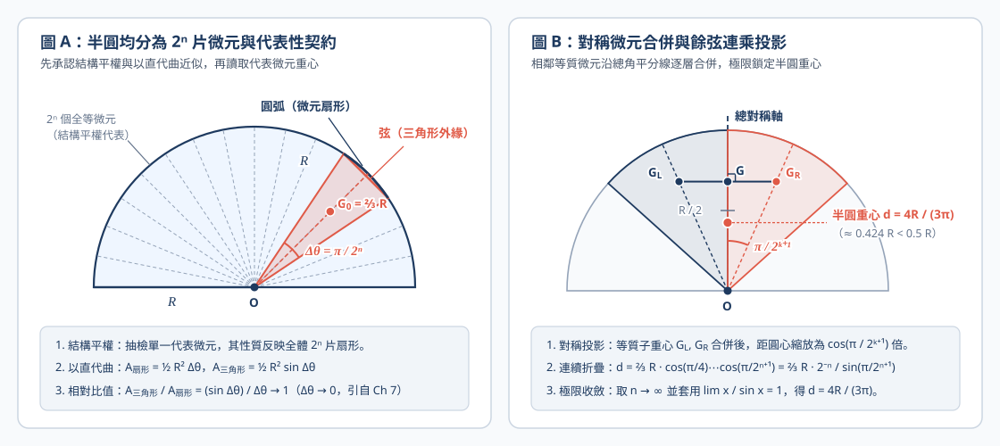

# 微元法的起手式：先承認微元具有代表性，再開始使用

## 一、承前：規則圖形的幾何安全區

在國中幾何中，面對邊界筆直或高度對稱的圖形，我們總能輕鬆鎖定重心位置。例如對於任意等腰三角形，重心必落在頂角的角平分線上，而且距離頂點的長度剛好是高的 $\frac{2}{3}$。

只要邊界都是直線，現有的初等幾何工具就完全夠用。

## 二、起意：在動手切分之前，先承認微元的代表性

一旦碰到「半圓」這種邊界處處彎曲的圖形，國中重心公式便會立刻失效。

為了解決彎曲邊界，我們將半圓（圓心角 $\pi$）沿半徑對半切分 $n$ 次，分割成 $2^n$ 個圓心角只有 $\Delta\theta = \frac{\pi}{2^n}$ 的狹長小扇形（配合 `semicircle_centroid.svg` 之圖 A）。每一小片扇形，就是我們分析整體的最小單元，稱為「微元」。

在正式動筆計算之前，我們不能把近似當成理所當然的魔術，而必須先停下來，在觀念上承認這片微元具有「代表性」。這份代表性包含兩層核心內涵。

### 1. 結構平權的代表性（抽一片，看全體）

半圓經過均勻對分後，切出來的 $2^n$ 個小扇形彼此完全全等，沒有任何一片享有特殊地位。它們具備完全相同的面積權重與幾何對稱性。只要我們解剖清楚其中任意一片微元的構造與性質，這一小片就足以代表全體 $2^n$ 個扇形的共同行為。

### 2. 以直代曲的幾何代表性（用等腰三角形代表小扇形）

仔細觀察圖 A 中高亮的那片狹窄扇形，它的外緣依然是一小段圓弧，嚴格說來還不是三角形。但是當切分次數 $n$ 越來越大、頂角 $\Delta\theta$ 縮到極小時，連接圓弧兩端點的弦幾乎緊貼著弧線。

我們不必猜測，直接寫出真實小扇形與近似等腰三角形的面積來比較：

$$
A_{\text{扇形}} = \frac{1}{2} R^2 \Delta\theta, \qquad A_{\text{三角形}} = \frac{1}{2} R^2 \sin\Delta\theta
$$

將兩者的面積相除，觀察它們的相對比例：

$$
\frac{A_{\text{三角形}}}{A_{\text{扇形}}} = \frac{\sin\Delta\theta}{\Delta\theta}
$$

當頂角 $\Delta\theta \to 0$ 時，調用第 7 章已確立的重要極限，這個比值嚴格收斂於 $1$（弧長與弦長之比亦同）。這說明在極小尺度下，等腰三角形與小扇形的幾何差異已經退隱，等腰三角形在「面積權重」與「形狀輪廓」上，完全沒有失真。

因此，我們有充分的幾何理由先承認這件事，也就是在 $\Delta\theta$ 極小時，一個頂角為 $\Delta\theta$、腰長為 $R$ 的等腰三角形，就是微元扇形的忠實代表。確認並承認這個前提後，我們才正式開始使用它。

## 三、推演：承認代表性之後，啟動微元運算

既然我們已經承認微元具備上述雙重代表性，現在就能安穩地展開推導（配合 `semicircle_centroid.svg` 之圖 B）。

### 步驟 1：讀取單一代表微元的重心

由我們所承認的等腰三角形代表（在極限下高即為半徑 $R$），國中重心性質立刻告訴我們，每一片微元的重心 $G_0$ 都落在角平分線上，距離圓心 $O$ 為：

$$
G_0 = \frac{2}{3} R
$$

### 步驟 2：同質微元的對稱合併與餘弦投影

因為全體 $2^n$ 個微元都具有同等的代表結構與重量，相鄰兩片對稱扇形（角平分線夾角為 $\frac{\pi}{2^k}$）的子重心 $G_L$ 與 $G_R$ 質量相等。根據等腰三角形三線合一的性質，兩者合併後的合成重心 $G$ 必落在總角平分線上，距離圓心變為原本的半頂角餘弦倍數，即 $\cos\left(\frac{\pi}{2^{k+1}}\right)$ 倍。

### 步驟 3：由內向外連續合併的餘弦連乘

從最細微的代表微元出發，逐次向外合併 $n$ 次至完整半圓，重心距圓心距離 $d$ 為：

$$
d = \frac{2}{3}R \cdot \cos\left(\frac{\pi}{4}\right)\cos\left(\frac{\pi}{8}\right)\cos\left(\frac{\pi}{16}\right)\cdots\cos\left(\frac{\pi}{2^{n+1}}\right)
$$

為化簡這串餘弦連乘，將分子與分母同乘 $\sin\left(\frac{\pi}{2^{n+1}}\right)$，並利用二倍角公式 $\sin\theta\cos\theta = \frac{1}{2}\sin(2\theta)$ 由右向左連續折疊 $n$ 次：

$$
\begin{aligned}
d &= \frac{2}{3}R \cdot \frac{\cos\frac{\pi}{4}\cos\frac{\pi}{8}\cdots\cos\frac{\pi}{2^{n+1}}\sin\frac{\pi}{2^{n+1}}}{\sin\left(\frac{\pi}{2^{n+1}}\right)} \\
&= \frac{2}{3}R \cdot \frac{2^{-n}\sin\left(\frac{\pi}{2}\right)}{\sin\left(\frac{\pi}{2^{n+1}}\right)} \quad \left(\because \sin\frac{\pi}{2} = 1\right) \\
&= \frac{4}{3}R \cdot \left[\frac{\pi \cdot 2^{-(n+1)}}{\sin\left(\pi \cdot 2^{-(n+1)}\right)}\right] \cdot \frac{1}{\pi}
\end{aligned}
$$

### 步驟 4：取極限鎖定精確解

取無窮極限 $n \to \infty$，令角度參數 $x = \pi \cdot 2^{-(n+1)} \to 0$。調用重要極限 $\lim_{x \to 0} \frac{x}{\sin x} = 1$，得出半圓重心距圓心的距離：

$$
d = \lim_{n \to \infty} \frac{4}{3}R \cdot \left[\frac{\pi \cdot 2^{-(n+1)}}{\sin\left(\pi \cdot 2^{-(n+1)}\right)}\right] \cdot \frac{1}{\pi} = \frac{4R}{3\pi}
$$

## 四、結實：回頭檢驗與微元使用紀律

### 1. 推廣與首尾檢驗

若將半圓推廣至圓心角為 $2\alpha$ 的任意扇形，最後一次對稱合併的半角改為 $\frac{\alpha}{2}$，二倍角折疊的最終項為 $2\cos\left(\frac{\alpha}{2}\right)\sin\left(\frac{\alpha}{2}\right) = \sin\alpha$，因此得到任意扇形的重心公式：

$$
d = \frac{2R\sin\alpha}{3\alpha}
$$

我們可以用這條公式回頭檢驗兩個端點，確認當初承認的代表性完全自洽。

- **端點檢驗一（半圓還原）**：令 $\alpha = \frac{\pi}{2}$，得到 $d = \frac{4R}{3\pi} \approx 0.424R$。重心落在靠近直徑、低於半徑一半的寬廣區域，完全符合直覺。
- **端點檢驗二（退化為單一微元）**：令 $\alpha \to 0$，得到 $d = \frac{2}{3}R \cdot \lim_{\alpha \to 0} \frac{\sin\alpha}{\alpha} = \frac{2}{3}R$，分毫不差地還原回我們在起點所承認的三角形微元重心。

### 2. 使用微元的標準順序（先立約，再運算）

透過這次推導，未來在微積分與物理中面對任何彎曲或連續變化的問題，只要嚴守這四個順序即可。

1. **承認代表性**：先確認切分後的單一微元具備結構平權性，且簡單形體（等腰三角形、矩形或切線段）在極限尺度下足以忠實代表彎曲局部。
2. **讀取代表性質**：寫出這單一代表微元的面積、重心或局部變化量（本例即 $G_0 = \frac{2}{3}R$）。
3. **執行全域組合**：利用對稱合成或累積求和規則，將所有微元統整回整體。
4. **極限收斂鎖定**：令切分無限細化，讓微觀偏差完全歸零，得出精確的宏觀封閉解。

## 五、體系序位與雙軌交叉驗證

依循本體系的因果自洽與零賒帳原則，極限 $\lim_{\theta \to 0} \frac{\sin\theta}{\theta} = 1$ 確立於 **Chapter 7**，因此本模組嚴格置於 Chapter 7 之後，沿著 `Chapter 7` 到 `Chapter 10` 再到 `Chapter 12` 的鏈條運作。

| 體系章節 | 核心節點與公式編號 | 本模組之角色與因果閉環 |
| :--- | :--- | :--- |
| **Chapter 7** | `Eq 7.2`、`Eq 7.3`、`Ex 7.1`、`Th 7.3` | 以面積夾擠證畢 $\lim_{\Delta\theta \to 0} \frac{\sin\Delta\theta}{\Delta\theta} = 1$，埋下「小扇形與等腰三角形面積比趨近於 $1$」的幾何伏筆。 |
| **Chapter 10** | 編寫指南、`Q1 10.1` | 開篇導入本模組作為「微元法起手式」，完成半圓重心 $\frac{4R}{3\pi}$ 的免積分演繹後，順暢過渡至黎曼矩形分割求和。 |
| **Chapter 12** | `Eq 12.6`、`Ex 12.2` | 以第一面積矩定積分 $\bar{y} = \frac{\int_{-R}^R \frac{1}{2}(R^2-x^2)\,\mathrm{d}x}{\frac{1}{2}\pi R^2} = \frac{4R}{3\pi}$ 交叉驗證，與本章餘弦連乘結果完全吻合。 |
