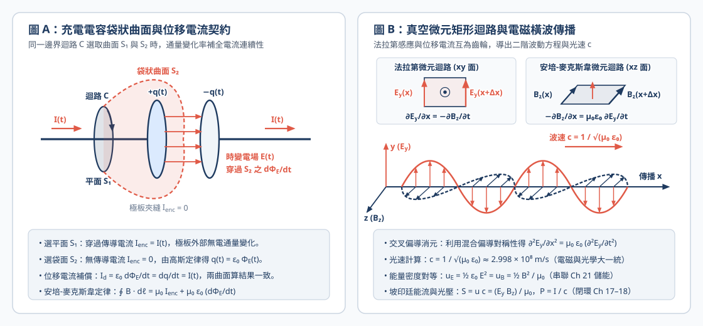

# 麥克斯韋電磁架構：從微元通量環流到電磁波大一統

## 前置定位：電磁架構在 28 章微積分體系中的零賒帳序位

在進入電磁場統一架構之前，全書先前章節已經逐一備齊所需的數學算子與物理定律。本模組將分散於力學、電路與磁場章節的線索收束為完整閉環，不預支未教的高維抽象算子，只憑藉已確立的微元積分與偏導數即可完成推導。

| 先備章節 | 已確立的數學與物理工具 | 在麥克斯韋架構中的作用 |
| :--- | :--- | :--- |
| **Chapter 7–8** | 弧度無量綱化、$\sin$ 與 $\cos$ 導數、旋轉向量微商 | 支撐電磁場正弦振盪、簡諧相位與法拉第感應微分表達式。 |
| **Chapter 10–13** | 黎曼微元求和、微積分基本定理、線積分與保守場判據 | 確立環流線積分 $\oint \vec{F}\cdot\mathrm{d}\vec{\ell}$ 與非保守渦旋場之辨識基準。 |
| **Chapter 18** | RC、RL 暫態電路微分方程與電容充放電、`P9 18.2` | 提出充電電容迴路與無電阻超導迴路的輻射能量去向疑問。 |
| **Chapter 21** | 相空間三角形積分與電磁場儲能係數 $\frac{1}{2}$ | 建立電場能量密度 $u_E = \frac{1}{2}\varepsilon_0 E^2$ 與磁場能量密度 $u_B = \frac{1}{2\mu_0}B^2$。 |
| **Chapter 22** | 畢奧-薩伐爾定律與穩恆安培環路定理 `Eq 22.6` | 建立磁場環流積分 $\oint \vec{B}\cdot\mathrm{d}\vec{\ell} = \mu_0 I_{\text{enc}}$，並準備迎接時變修訂。 |
| **Chapter 25–26** | 多變數偏導數、克萊羅混合偏導對稱性與二重面積分 | 支撐微元平面矩形迴路化簡與二階波動方程交叉消元。 |
| **Chapter 17 & 28** | 光子動量流率與光壓 `Eq 17.6`、交流電均方根與能流 | 完成真空光速 $c = \frac{1}{\sqrt{\mu_0\varepsilon_0}}$ 與坡印廷能流對等之終局閉環。 |

---

## 一、承前：電場與磁場的兩種微元積分測量

延續微元法「先承認代表性，再開始使用」的紀律，當我們進入三維空間場論時，任何彎曲的空間曲面與封閉曲線，都能切分為極小的平坦小片微元 $\mathrm{d}\vec{A}$ 與筆直的有向線段微元 $\mathrm{d}\vec{\ell}$。在極小尺度下，場向量在單一微元上視為均勻常數，於是我們獲得度量向量場空間結構的兩個積分算子。

1. **曲面通量（Flux）**：將空間向量場在每個面積微元上的法向分量累加，度量穿過曲面的場線淨數量。

$$
\Phi_E = \oiint_S \vec{E} \cdot \mathrm{d}\vec{A}, \qquad \Phi_B = \oiint_S \vec{B} \cdot \mathrm{d}\vec{A}
$$

2. **閉合環流（Circulation）**：沿封閉路徑 $C$ 逐段計算場向量與切線位移微元 $\mathrm{d}\vec{\ell}$ 的內積總和，度量場線繞圈打轉的程度（第 13 章中保守電場的環流為零，而感應渦旋場的環流不為零）。

$$
\Gamma_E = \oint_C \vec{E} \cdot \mathrm{d}\vec{\ell}, \qquad \Gamma_B = \oint_C \vec{B} \cdot \mathrm{d}\vec{\ell}
$$

在麥克斯韋完成統一之前，電磁學已經由實驗與靜態微元積分累積了四條各自獨立的積分關係（涵蓋第 7 章 `P2 7.4`、第 11 章 `P5 11.1` 與第 22 章 `Eq 22.6`）：

- **電場高斯定律**：$\oiint_S \vec{E} \cdot \mathrm{d}\vec{A} = \frac{Q_{\text{enc}}}{\varepsilon_0}$（正負電荷是電場線的起點與終點）。
- **磁場高斯定律**：$\oiint_S \vec{B} \cdot \mathrm{d}\vec{A} = 0$（自然界尚未發現孤立磁單極子，磁感線處處閉合）。
- **法拉第電磁感應定律**：$\oint_C \vec{E} \cdot \mathrm{d}\vec{\ell} = -\frac{\mathrm{d}\Phi_B}{\mathrm{d}t}$（隨時間變化的磁通量會激發渦旋電場）。
- **穩恆安培環路定理**：$\oint_C \vec{B} \cdot \mathrm{d}\vec{\ell} = \mu_0 I_{\text{enc}}$（第 22 章在穩恆電流條件下確立）。

這四條式子看似已經覆蓋了電與磁的所有日常現象，但只要放進第 18 章最普通的充電電容器電路，第四條式子立刻就會發生嚴重的邏輯崩潰。

---

## 二、起意：充電電容袋狀曲面前的安培環路崩潰

觀察 `maxwell_electromagnetic_architecture.svg` 之圖 A。考慮一個正在充電的 RC 電路，導線以隨時間變化的電流 $I(t) = \frac{\mathrm{d}q}{\mathrm{d}t}$ 流向平行板電容器的左極板。

我們在左極板外側的導線周圍，畫定一條圓形的閉合安培迴路 $C$。根據穩恆安培環路定理，等號右邊的 $I_{\text{enc}}$ 代表「穿過以 $C$ 為邊界的任意曲面之總傳導電流」。現在我們故意對同一條邊界迴路 $C$ 選取兩個不同的張緊曲面。

1. **選取平面圓盤 $S_1$**：圓盤直接切斷導線，此時導線垂直穿過 $S_1$，因此穿過曲面的電流為 $I_{\text{enc}} = I(t) \neq 0$。安培定律給出 $\oint_C \vec{B} \cdot \mathrm{d}\vec{\ell} = \mu_0 I(t)$。
2. **選取鼓起的袋狀曲面 $S_2$**：保持邊界迴路 $C$ 完全不動，只把曲面像吹氣球一樣向右鼓起，讓曲面底部正好繞進電容器兩塊平行極板之間的真空夾縫。兩極板之間沒有任何真實自由電荷穿越，$S_2$ 截獲的傳導電流嚴格為 $I_{\text{enc}} = 0$。穩恆安培定律竟給出 $\oint_C \vec{B} \cdot \mathrm{d}\vec{\ell} = 0$。

同一條空間迴路 $C$、同一個時刻的磁場環流，僅因為輔助曲面選取方式不同，就得出 $\mu_0 I(t)$ 與 $0$ 兩個截然矛盾的結果。這直接宣告了穩恆安培環路定理在非穩恆（時變）電路中失效。

---

## 三、推演：位移電流補全四方程，微元矩形迴路推導光速

### 步驟 1：從電通量微商誕生「位移電流」

麥克斯韋注意到，袋狀曲面 $S_2$ 雖然沒有真實電荷穿過，但極板上的電荷 $q(t)$ 正在隨時間累積，極板間的電場 $\vec{E}(t)$ 隨時間增強，因此有隨時間變化的電通量 $\Phi_E(t)$ 正在穿透 $S_2$。

將高斯的電場通量定律套用在包圍左極板的閉合面（由 $S_2$ 與左側開口構成，極板外側場可視為集中於板間），電容器左極板所帶電荷 $q(t)$ 與向右穿透 $S_2$ 的電通量之間存在精確等式：

$$
\Phi_E(t) = \iint_{S_2} \vec{E}(t) \cdot \mathrm{d}\vec{A} = \frac{q(t)}{\varepsilon_0} \implies q(t) = \varepsilon_0 \Phi_E(t)
$$

兩端同時對時間 $t$ 求導數，電容器極板電荷的變化率恰好就是導線流過 $S_1$ 的傳導電流 $I(t)$：

$$
I(t) = \frac{\mathrm{d}q}{\mathrm{d}t} = \varepsilon_0 \frac{\mathrm{d}\Phi_E}{\mathrm{d}t}
$$

這個具有電流因次的項 $I_d = \varepsilon_0 \frac{\mathrm{d}\Phi_E}{\mathrm{d}t}$ 稱為**位移電流（Displacement Current）**。只要把這項補進安培環路定理右端，無論選取平面 $S_1$（$I_{\text{enc}} = I(t),\, I_d = 0$）還是袋狀曲面 $S_2$（$I_{\text{enc}} = 0,\, I_d = I(t)$），等號右端永遠精確等於 $\mu_0 I(t)$，幾何矛盾徹底消除。安培-麥克斯韋定律由此確立：

$$
\oint_C \vec{B} \cdot \mathrm{d}\vec{\ell} = \mu_0 I_{\text{enc}} + \mu_0 \varepsilon_0 \frac{\mathrm{d}\Phi_E}{\mathrm{d}t}
$$

### 步驟 2：麥克斯韋方程組的全域積分架構

補齊位移電流後，電場與磁場的對稱性瞬間打開。時變磁場生電場（法拉第定律），時變電場生磁場（安培-麥克斯韋定律），完整的麥克斯韋四方程組積分形式如下：

$$
\begin{aligned}
\oiint_S \vec{E} \cdot \mathrm{d}\vec{A} &= \frac{Q_{\text{enc}}}{\varepsilon_0} \\
\oiint_S \vec{B} \cdot \mathrm{d}\vec{A} &= 0 \\
\oint_C \vec{E} \cdot \mathrm{d}\vec{\ell} &= -\frac{\mathrm{d}}{\mathrm{d}t}\iint_S \vec{B} \cdot \mathrm{d}\vec{A} \\
\oint_C \vec{B} \cdot \mathrm{d}\vec{\ell} &= \mu_0 I_{\text{enc}} + \mu_0 \varepsilon_0 \frac{\mathrm{d}}{\mathrm{d}t}\iint_S \vec{E} \cdot \mathrm{d}\vec{A}
\end{aligned}
$$

### 步驟 3：真空微元矩形迴路推導一維波動方程

為了檢驗這套方程在完全沒有電荷與導線的自由真空（$Q_{\text{enc}} = 0,\, I_{\text{enc}} = 0$）中會如何運作，我們不必超綱使用三維抽象向量旋度算子，只需調用第 25 章的多變數偏導數與第 10 章的微元代表性契約即可（配合 `maxwell_electromagnetic_architecture.svg` 之圖 B）。

考慮沿 $+x$ 方向推進的平面波，令電場僅沿 $y$ 軸震盪 $\vec{E} = E_y(x, t)\,\hat{\mathbf{j}}$，磁場僅沿 $z$ 軸震盪 $\vec{B} = B_z(x, t)\,\hat{\mathbf{k}}$。

**第一迴路（$xy$ 平面與法拉第定律）**：在 $xy$ 平面取寬度為 $\Delta x$、高度為 $h$ 的微小矩形迴路（逆時針繞行，法向量朝 $+\hat{\mathbf{k}}$）。上下兩條水平邊與 $\vec{E}$ 垂直，線積分貢獻為 $0$；左右兩條垂直邊沿 $\hat{\mathbf{j}}$ 相減，在 $\Delta x \to 0$ 極限尺度下代表磁通量為 $\Phi_B \approx B_z(x, t)\,h\,\Delta x$：

$$
\big[E_y(x + \Delta x, t) - E_y(x, t)\big] h = -\frac{\partial}{\partial t}\big[B_z(x, t)\,h\,\Delta x\big]
$$

兩邊同除以微元面積 $h\,\Delta x$ 並令 $\Delta x \to 0$，立刻化為第一條偏微分耦合式：

$$
\frac{\partial E_y}{\partial x} = -\frac{\partial B_z}{\partial t}
$$

**第二迴路（$xz$ 平面與安培-麥克斯韋定律）**：在 $xz$ 平面取寬度為 $\Delta x$、深度為 $w$ 的微小矩形迴路（依右手定則繞法向量 $+\hat{\mathbf{j}}$ 逆時針行進：左側在 $x$ 處沿 $+\hat{\mathbf{k}}$，右側在 $x+\Delta x$ 處沿 $-\hat{\mathbf{k}}$）。前後兩條水平邊與 $\vec{B}$ 垂直，線積分貢獻為 $0$；代表電通量為 $\Phi_E \approx E_y(x, t)\,w\,\Delta x$：

$$
\big[B_z(x, t) - B_z(x + \Delta x, t)\big] w = \mu_0 \varepsilon_0 \frac{\partial}{\partial t}\big[E_y(x, t)\,w\,\Delta x\big]
$$

兩邊同除以微元面積 $w\,\Delta x$ 並令 $\Delta x \to 0$，獲得第二條偏微分耦合式：

$$
-\frac{\partial B_z}{\partial x} = \mu_0 \varepsilon_0 \frac{\partial E_y}{\partial t}
$$

**交叉消元**：將第一式兩端對 $x$ 求偏導，並調用第 25 章 `P9 25.1` 的克萊羅混合偏導數對稱定理（$\frac{\partial^2 B_z}{\partial x \partial t} = \frac{\partial^2 B_z}{\partial t \partial x}$），將第二式對 $t$ 求偏導後代入消去磁場 $B_z$：

$$
\frac{\partial^2 E_y}{\partial x^2} = -\frac{\partial}{\partial x}\left(\frac{\partial B_z}{\partial t}\right) = -\frac{\partial}{\partial t}\left(\frac{\partial B_z}{\partial x}\right) = \mu_0 \varepsilon_0 \frac{\partial^2 E_y}{\partial t^2}
$$

同理消去 $E_y$，磁場也滿足完全對稱的一維波動方程：

$$
\frac{\partial^2 B_z}{\partial x^2} = \mu_0 \varepsilon_0 \frac{\partial^2 B_z}{\partial t^2}
$$

### 步驟 4：由電磁常數直接算定真空光速

在物理波動方程標準形式 $\frac{\partial^2 u}{\partial x^2} = \frac{1}{v^2}\frac{\partial^2 u}{\partial t^2}$ 中，任何形如 $f(x - vt)$ 的行進波代入均成立。將上式係數直接對比，得出真空中電磁波的理論傳播速率 $c$：

$$
c = \frac{1}{\sqrt{\mu_0 \varepsilon_0}}
$$

代入純粹來自磁學導線受力定義的真空磁導率 $\mu_0 = 4\pi \times 10^{-7}\,\mathrm{N/A^2}$，與靜電庫侖實驗測得的真空介電常數 $\varepsilon_0 \approx 8.854 \times 10^{-12}\,\mathrm{C^2/(N\cdot m^2)}$：

$$
c \approx \frac{1}{\sqrt{(4\pi \times 10^{-7})(8.854 \times 10^{-12})}} \approx 2.998 \times 10^8\,\mathrm{m/s}
$$

靜電學常數與靜磁學常數的倒數平方根，竟分毫不差地算出光學實驗測得的光速。光學自此被嚴格證明為電磁場波動的一種特例，完成人類物理史上第二次大一統。

---

## 四、結實：量綱驗證、能量流閉環與系統對照

### 1. 量綱審查（連結第 21 章儲能密度與勞侖茲力）

為確保 $\frac{1}{\sqrt{\mu_0 \varepsilon_0}}$ 的單位嚴格等於速率 $[\mathrm{L}][\mathrm{T}]^{-1}$，利用第 21 章推導出的電場與磁場單位體積儲能密度（量綱皆為 $\mathrm{J/m^3}$）：

$$
u_E = \frac{1}{2}\varepsilon_0 E^2, \qquad u_B = \frac{1}{2\mu_0} B^2
$$

由勞侖茲力平衡 $q E = q v B$ 可知電場與磁場之比 $\frac{E}{B}$ 具備速率因次 $\mathrm{m/s}$。因為 $u_E$ 與 $u_B$ 量綱相同，故乘積 $\mu_0 \varepsilon_0$ 的量綱滿足：

$$
[\mu_0 \varepsilon_0] = \left[\frac{u_E}{E^2} \cdot \frac{B^2}{u_B}\right] = \left[\frac{B}{E}\right]^2 = \frac{1}{[v]^2} \implies \left[\frac{1}{\sqrt{\mu_0\varepsilon_0}}\right] = \mathrm{m/s}
$$

### 2. 電磁能量對等與坡印廷能流（閉環第 17 章與第 18 章）

將右行平面波 $E_y(x, t) = E_0 \sin(kx - \omega t)$ 與 $\frac{\omega}{k} = c$ 代入耦合偏微分方程 $\frac{\partial E_y}{\partial x} = -\frac{\partial B_z}{\partial t}$，得出電場與磁場振幅的即時比例關係 $E_y = c B_z$。代回第 21 章的儲能密度公式：

$$
u_B = \frac{B_z^2}{2\mu_0} = \frac{(E_y / c)^2}{2\mu_0} = \frac{\mu_0 \varepsilon_0 E_y^2}{2\mu_0} = \frac{1}{2}\varepsilon_0 E_y^2 = u_E
$$

這證明在自由傳播的電磁波中，電場與磁場各承擔精確相等的 $50\%$ 能量密度，總能量密度為 $u = u_E + u_B = \varepsilon_0 E_y^2 = \frac{1}{\mu_0 c} E_y B_z$。能量以速率 $c$ 沿波傳方向流過單位截面的功率密度（坡印廷能流強度）為：

$$
S = u c = \frac{E_y B_z}{\mu_0}
$$

當電磁波攜帶能量流密度 $I = S$ 垂直照射物體表面時，第 17 章 `Eq 17.6` 所推導的光壓公式 $P_{\text{abs}} = \frac{I}{c} = u$ 立刻顯示光壓在數值上正等於電磁場能量密度；同時第 18 章 `P9 18.2` 中無電阻超導雙電容重新分配電荷所損耗的 $\frac{1}{2}CV^2$ 能量，也正是透過上述電磁波輻射以能流 $S$ 帶離電路，達成電路、場論與光學的完整能量守恆閉環。

### 3. 進階橋接表：積分全域契約與微分局部算子

在完成 28 章單變數與二維積分訓練後，學習者進入大學向量分析時，只需借助高斯散度定理與斯托克斯旋度定理（第 26 章 `P9 26.1` 格林定理的三維推廣），即可將本模組的積分四方程一鍵翻譯為局部微分形式：

| 定律名稱 | 全域積分形式（本體系微元積分手算主線） | 局部微分形式（銜接大學向量微積分 $\nabla$ 算子） |
| :--- | :--- | :--- |
| **電場高斯定律** | $\oiint_S \vec{E} \cdot \mathrm{d}\vec{A} = \frac{Q_{\text{enc}}}{\varepsilon_0}$ | $\nabla \cdot \vec{E} = \frac{\rho}{\varepsilon_0}$ |
| **磁場高斯定律** | $\oiint_S \vec{B} \cdot \mathrm{d}\vec{A} = 0$ | $\nabla \cdot \vec{B} = 0$ |
| **法拉第感應定律** | $\oint_C \vec{E} \cdot \mathrm{d}\vec{\ell} = -\frac{\mathrm{d}\Phi_B}{\mathrm{d}t}$ | $\nabla \times \vec{E} = -\frac{\partial \vec{B}}{\partial t}$ |
| **安培-麥克斯韋定律** | $\oint_C \vec{B} \cdot \mathrm{d}\vec{\ell} = \mu_0 I_{\text{enc}} + \mu_0 \varepsilon_0 \frac{\mathrm{d}\Phi_E}{\mathrm{d}t}$ | $\nabla \times \vec{B} = \mu_0 \vec{J} + \mu_0 \varepsilon_0 \frac{\partial \vec{E}}{\partial t}$ |
